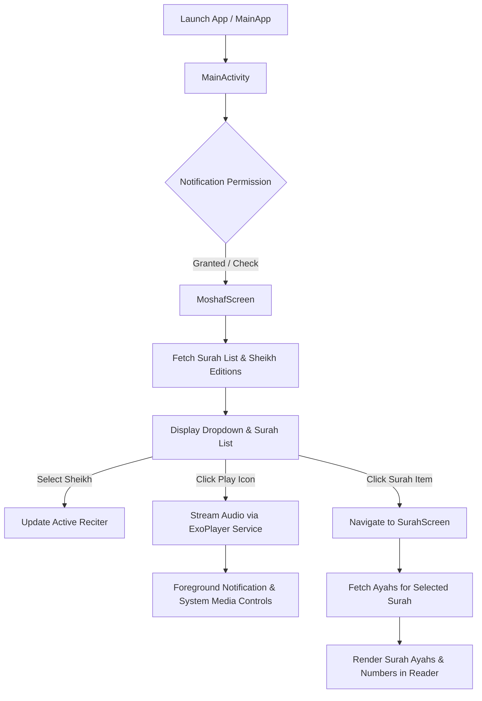

# SadkaQuran (صدقة جارية) 📖🎧

**SadkaQuran** is a modern Android application built with Jetpack Compose, Kotlin Coroutines, Dagger Hilt, and ExoPlayer. It serves as an ongoing charity (*Sadka Jariyah*), providing Muslims worldwide with an intuitive platform to read the Holy Quran, discover reciters (Sheikhs), and stream high-quality audio recitations both in the foreground and in the background.

---

## 🌟 Key Features & Business Logic

1. **Surah Browsing & Discovery**:
   - Fetches and displays all 114 Surahs of the Holy Quran from the **Al-Quran Cloud REST API**.
   - Displays Surah numbers, Arabic names, English titles, revelation type (Meccan / Medinan), and ayah count.

2. **Multi-Reciter Selection (Sheikh Dropdown)**:
   - Fetches available Quranic audio editions and reciters dynamically from the API.
   - Allows users to select their preferred reciter (e.g., Sheikh Abdullah Basfar, Mishary Alafasy, and others) via an interactive dropdown menu.

3. **Audio Streaming & Background Playback**:
   - Streams audio recitations from the Islamic Network CDN (`https://cdn.islamic.network/quran/audio-surah/128/{identifier}/{surahNumber}.mp3`).
   - Integrated with **Android MediaBrowserServiceCompat** and **MediaSessionCompat** for system-level media integration.
   - Background audio playback supported by a foreground service (`MusicService`) and rich notification controls (`MusicNotificationManger`) allowing play, pause, seek, and track navigation from notifications and lock screen.
   - Local in-app playback fallback via `MediaPlayerManager`.

4. **Interactive Surah Reader**:
   - Tap any Surah to open a dedicated reader screen.
   - Dynamically loads and displays full Surah Ayahs (verses) along with decorative Islamic borders and verse numbers.

5. **Offline & Network Resilience**:
   - Connectivity monitoring before firing network requests.
   - Visual feedback for loading progress, network errors, timeouts, and empty states.

---

## 🔄 App Workflow & Navigation



### Screen Flow:
1. **`MoshafScreen` (`"moshaf"`)**:
   - Main entry screen.
   - Uses `MoshafViewModel` to request all Surahs (`/surah`) and reciters (`/edition/format/audio`).
   - Connects to `MusicServiceConnection` to observe audio playback state (playing, paused, buffering).
   - Allows quick playback of any Surah directly from the list.
2. **`SurahScreen` (`"surah/{number}/{identifier}"`)**:
   - Detailed reader screen navigated via Jetpack Compose Navigation arguments (`number`, `identifier`).
   - Uses `SurahViewModel` to fetch the specific Surah and its constituent Ayahs (`/surah/{number}`).
   - Renders verses in an animated lazy-loading column (`SurahRead` & `ItemAyah`).

---

## 🏗️ Architecture & Design Patterns

The project adheres to modern Android Architecture principles and Clean Architecture / MVVM best practices:

- **Model-View-ViewModel (MVVM)**: Clear separation of UI presentation (`@Composable` screens), business logic / state management (`ViewModel`), and data access (`Repository`).
- **Unidirectional Data Flow (UDF)**: ViewModels expose immutable `StateFlow` and `LiveData` states (`Resource<T>`), consumed by Compose UI with `collectAsState()` and `observeAsState()`.
- **Dependency Injection (DI)**: Dagger Hilt handles scoping and injection across the application (`@HiltAndroidApp`, `@AndroidEntryPoint`, `@HiltViewModel`, `@InstallIn(SingletonComponent::class)`).
- **Service-Oriented Audio Architecture**: ExoPlayer runs inside a dedicated background service (`MusicService`) extending `MediaBrowserServiceCompat`, communicating with UI through `MusicServiceConnection` and `MediaControllerCompat`.

---

## 🛠️ Technologies & Libraries

| Technology | Purpose |
| :--- | :--- |
| **Kotlin** | Primary language for Android development |
| **Jetpack Compose** | Declarative modern UI toolkit (Material Components, LazyColumn, Animations) |
| **Compose Navigation** | In-app routing with type-safe argument passing |
| **Dagger Hilt** | Dependency injection framework for Android |
| **Kotlin Coroutines & Flow** | Asynchronous execution, reactive streams, and state management |
| **Retrofit 2 & OkHttp 3** | Type-safe REST client for network communications and logging interceptor |
| **Gson** | JSON parsing and serialization |
| **ExoPlayer (Media2 / Media3)** | Robust media player for audio streaming and queue management |
| **AndroidX Media** | `MediaSessionCompat`, `MediaBrowserCompat`, and background playback lifecycle |
| **Coil & Glide** | Image loading and caching for reciter art and media notifications |
| **Timber** | Extensible logging utility |

---

## 📁 Project Structure

```
Sadka/
├── app/
│   ├── src/
│   │   ├── main/
│   │   │   ├── AndroidManifest.xml
│   │   │   ├── java/com/example/sadkaquran/
│   │   │   │   ├── MainActivity.kt               # Root Activity setting up NavHost and Compose theme
│   │   │   │   ├── MainApp.kt                    # Application class with @HiltAndroidApp
│   │   │   │   ├── data/
│   │   │   │   │   ├── models/                   # Data classes (Surah, Ayah, Sheikh, Elmoshaf, etc.)
│   │   │   │   │   └── remote/                   # Retrofit API interface (QuranApiService)
│   │   │   │   ├── di/                           # Hilt DI modules (AppModule, QuranModule, ServiceModule)
│   │   │   │   ├── exoplayer/                    # MusicService, NotificationManager, Connection & Callbacks
│   │   │   │   ├── navigation/                   # Screens enum & NavGraph navigation host
│   │   │   │   ├── repo/                         # Repository implementation for network requests
│   │   │   │   ├── ui/
│   │   │   │   │   ├── component/                # Reusable UI widgets (Dropdown, Loading, Error)
│   │   │   │   │   ├── feature/
│   │   │   │   │   │   ├── moshaf/               # MoshafScreen & MoshafViewModel
│   │   │   │   │   │   └── surah/                # SurahScreen & SurahViewModel
│   │   │   │   │   └── theme/                    # Color, Typography, Shape, and MaterialTheme
│   │   │   │   └── util/                         # Constants, Event wrapper, Resource states, MediaPlayer
│   │   │   └── res/                              # Drawables, mipmaps, string resources, XML configs
│   │   └── test/ / androidTest/                  # Unit and instrumentation test suites
│   └── build.gradle                              # App-level build configurations & dependencies
├── gradle/wrapper/                               # Gradle wrapper binaries & properties
├── build.gradle                                  # Top-level Gradle configuration
├── settings.gradle                               # Project repositories & module declarations
└── gradle.properties                             # Build system properties and JVM options
```

---

## 🌐 External APIs & CDNs

- **Metadata & Texts**: [Al-Quran Cloud REST API](http://api.alquran.cloud/v1/)
  - `GET /surah`: List of all Surahs
  - `GET /surah/{number}`: Detailed Ayahs of a specific Surah
  - `GET /edition/format/audio`: Available Sheikhs and audio editions
- **Audio CDN**: [Islamic Network CDN](https://cdn.islamic.network)
  - `https://cdn.islamic.network/quran/audio-surah/128/{identifier}/{surahNumber}.mp3`

---

## 🚀 Getting Started

### Prerequisites
- **Android Studio**: Ladybug / Meerkat or newer recommended
- **JDK**: Java 17 or Java 21
- **Android SDK**: `compileSdk 34+`, `minSdk 26`, `targetSdk 34+`

### Setup & Run
1. Clone the repository:
   ```bash
   git clone <repo-url>
   cd Sadka
   ```
2. Build the project:
   ```bash
   ./gradlew assembleDebug
   ```
3. Install and run on a connected device or emulator:
   ```bash
   ./gradlew installDebug
   ```
